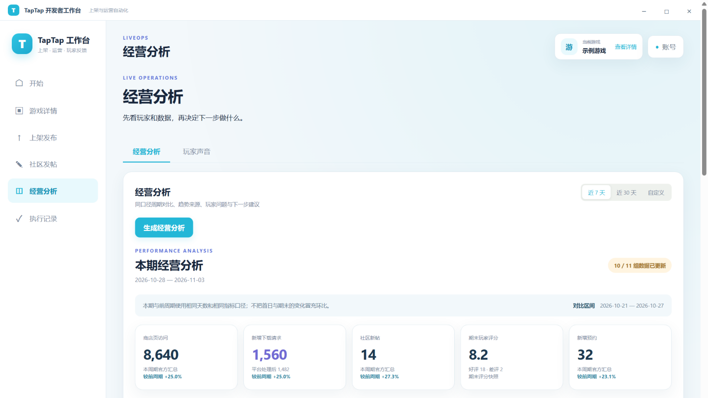

# TapTap 开发者工作台

面向游戏开发者的 Windows 桌面工作台，把 TapTap 游戏创建、资料与素材维护、包体上传、审核版本管理、社区发帖、官方草稿箱和周期经营分析集中到一个应用中。

> 本项目不是 TapTap 官方产品。自动化执行层使用官方 `@taptap/cli`，社区编辑器使用 TapTap 官方页面；账号权限、接口能力和审核结果以官方当次返回为准。



> 图中为脱敏示例游戏与运营数据，仅用于界面展示。

## 下载与运行

在 [Releases](../../releases) 下载 `TapTap-Workbench-0.7.6-Windows-x64.exe`。这是 Windows x64 单文件便携版，无需安装 Node.js、启动网页服务或打开命令行。

首次使用：

1. 在右上角打开“账号”，选择游戏项目文件夹。
2. 点击连接账号，在应用内完成 TapTap 官方授权。
3. 选择开发者和游戏；之后可在“游戏详情”和各工作流中操作。
4. 切换账号时使用“退出并切换账号”。应用会执行官方登出并清理自己的授权会话与旧游戏选择，不会清理其他浏览器的 Cookie。

包体和素材通过系统文件选择器选取。账号授权、执行记录和报告保存在本机，不应复制进源码仓库。

## 主要能力

- **创建新游戏**：五步向导核对厂商关系、名称、类型和包体方向；创建成功后只进入草稿，不自动提审或上线。
- **上架体检**：汇总基础资料、素材、包体、平台分发、发布设置、资质、测试计划和版本历史，先显示结论与可点击待办。
- **连续发布流程**：按官方真实字段编辑；图片上传后回填 `{url, info}`，视频上传后回填数字 `videoId`；支持 APK、Windows、H5 和 Tap 小游戏相关能力。
- **审核与版本管理**：固定执行快照、同上线方式预检、独立确认提审；按真实状态提供撤审、撤定时、改定时和到期发布。
- **社区创作**：应用内嵌入官方富文本编辑器和官方草稿箱，支持素材上传、帖子管理、预览后发布及社区回复。
- **经营分析**：按周期汇总访问、下载、预约、评价、帖子、论坛趋势与近期差评，提供趋势图、来源分析、玩家问题和数据缺口；原始返回折叠在附录。
- **执行记录**：保存动作、预览、结果、指纹和幂等键。同一预览重复确认不会再次调用 CLI。

## 写入门禁

1. 写入动作首先只执行 `--dry-run`，不会直接正式写入。
2. 预览成功后才出现确认弹窗，必须输入该动作的完整确认语。
3. 正式执行复用同一份业务参数与幂等键，只追加 `--yes`。
4. 结果不明时先核对官方状态和本地记录，不自动重试。
5. 正式提审、撤审、上线、公开发帖和回复都属于高风险动作，必须逐项确认。

## 从源码开发

要求：Windows、Node.js 24，以及可访问 npm 的网络环境。

在 GitHub 仓库页面复制当前仓库地址，替换下面的 `YOUR_REPOSITORY_URL`：

```powershell
git clone YOUR_REPOSITORY_URL
cd taptap-developer-workbench
npm ci
npm run dev
```

依赖全部安装在当前项目的 `node_modules`，不会修改全局 Node.js 或其他工具环境。`npm run web` 仅保留为旧网页调试入口，日常使用以桌面应用为主。

### 构建单文件版本

```powershell
npm run desktop:build
```

产物位于 `release/TapTap-Workbench-0.7.6-Windows-x64.exe`。该目录以及 Electron 下载缓存均已加入 `.gitignore`。

### 验证

```powershell
npm test
npm run desktop:smoke
```

单元测试和桌面验收使用脱敏数据、假 CLI 与本地临时目录，不登录真实账号、不上传、不发帖、不提审。真实账号状态、权限、审核与发布结果仍须在正式使用前由使用者核对。

## 数据与限制

- `output/`、运行记录、报告、登录会话、依赖和构建产物不会纳入版本控制。
- 上传包体不会替代应用签名、真机测试、TapTap 登录验收或平台审核。
- CLI 未覆盖的能力应转到 TapTap 开发者中心完成，不拼造接口或伪造成功状态。
- 这是自动化辅助工具，不会绕过人工确认，也不会承诺平台审核结果。
